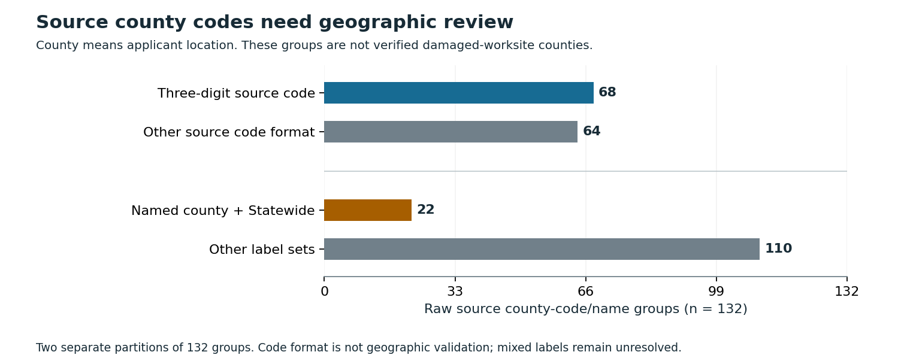

# Check disaster snapshots before publishing county comparisons

A refresh date does not preserve past funding values, and a county code does not prove where work occurred. This repository checks both assumptions in a fixed OpenFEMA capture and supplies a local comparison guard.

**Finding:** the capture contains 17,994 current records for disasters 4332 (TX) and 4339 (PR). Filtering current lastRefresh values at the four pre-2026 cutoffs selects none. At the 2018 probe, the source first-obligation calendar filter instead selects 3,155 and 875 current records. Neither result reconstructs funding as it was known in 2018.

**Geographic limit:** 22 source county-code groups mix a named county with Statewide labels. FEMA defines county as applicant location. These are raw source groups, not certified physical counties or county spending estimates.

## Practical use

Before publishing a historical county comparison, retain actual dated value tables, the source version, financial field, population definition, geographic meaning and capture evidence. The guard rejects metadata-only observations and current-record filters as historical values. It also rejects applicant-location-to-worksite and grant-field-to-cash conversions.

~~~powershell
python -m pip install -r requirements-replay.txt
python src/replay.py --out ../disaster-audit-replay
~~~

Use a new output directory. The replay checks frozen inputs, reproduces five result files, runs independent exact arithmetic and authored fixtures, then checks figures and the manuscript. It uses saved county/date sufficient data; it does not redownload mutable native records or establish historical financial values.

The [seven runnable requests](results/exercise.json) accept a qualified current description and reject six unsupported requests. See [the exercise](EXERCISE.md) and [guard code](src/snapshot_guard.py). This is a local implementation; no deployment or measured workflow saving is claimed.

## Results and evidence

- [Independent five-page manuscript](paper/manuscript.pdf), [LaTeX](paper/main.tex) and three original figures. Not peer reviewed.
- [All 134 current groups](results/current_totals.csv), [all 1,340 fixed probes](results/probe_metrics.csv), [metadata comparison](results/metadata_comparison.json) and [scope summary](results/summary.json).
- [Source-group interpretation](data/README.md), [retained county labels](data/county_catalog.json), [county/date sufficient cells](data/county_date_cells.csv), [capture hashes](data/capture_manifest.json) and [native verification](data/native_verification.json).
- [Fixed protocol](PROTOCOL.md), [committed 26-dependency freeze](PLAN_FREEZE.json), [source history](SOURCE_HISTORY.md) and [source terms](DATA_RIGHTS.md).
- Independent native reconstruction: 141,166 finite conditions. Saved-source checks: 49,237. Complete current-group/probe checks: 18,526 exact-rational/calendar conditions. Current authored fixtures: 38 methods, including whole duplicate-group quarantine and unavailable-money boundaries. Two aggregation fixtures were added after initial probe checks without changing source/probe rules.
- Separate full-history CPython [3.10.11](results/reproduction_cpython310.json) and [3.12.14](results/reproduction_cpython312.json) replays reproduce five outputs exactly, with all 11 data-directory files unchanged.
- [Figure checks](figures/verification.json): 44 source-bound bars, 176 actual SVG coordinate conditions, nine hashes and 910 finite conditions. [Paper checks](paper/verification.json) bind the used source values, PDF text, required FEMA notice and scoped bytes.

## Read the limits

The original stability-horizon question remains unexecuted. The inspected packet has two actual metadata observations and one current financial-value capture, with no established historical county-value series. Equal metadata, a completed reload and old first-obligation dates do not supply the earlier monetary values.

The source excludes pre-obligation projects and includes migration-related population changes. federalShareObligated is reported grant funding available to the grantee, not paid cash or official financial reporting. Source code formats and Statewide/county mixtures require geographic reconciliation; no dollars are allocated to physical counties or ranked as local need.

This is a source-informed finite convenience cohort. No waiting horizon, revision error, recovery effect, national reliability, predictive improvement, financial saving or new estimator is claimed. The guard checks curated evidence tags; it does not independently certify another producer's facts or geographic mappings.

Native project records and identifiers remain private. The public package contains factual sufficient aggregates, code and this independent program manuscript. Azure optimization and other formal-publication projects remain private.

Source: OpenFEMA PublicAssistanceFundedProjectsDetails v2, captured 31 October 2026 UTC. Exact times, URLs and hashes are retained.

This product uses the Federal Emergency Management Agency’s OpenFEMA API, but is not endorsed by FEMA. The Federal Government or FEMA cannot vouch for the data or analyses derived from these data after the data have been retrieved from the Agency's website(s).
